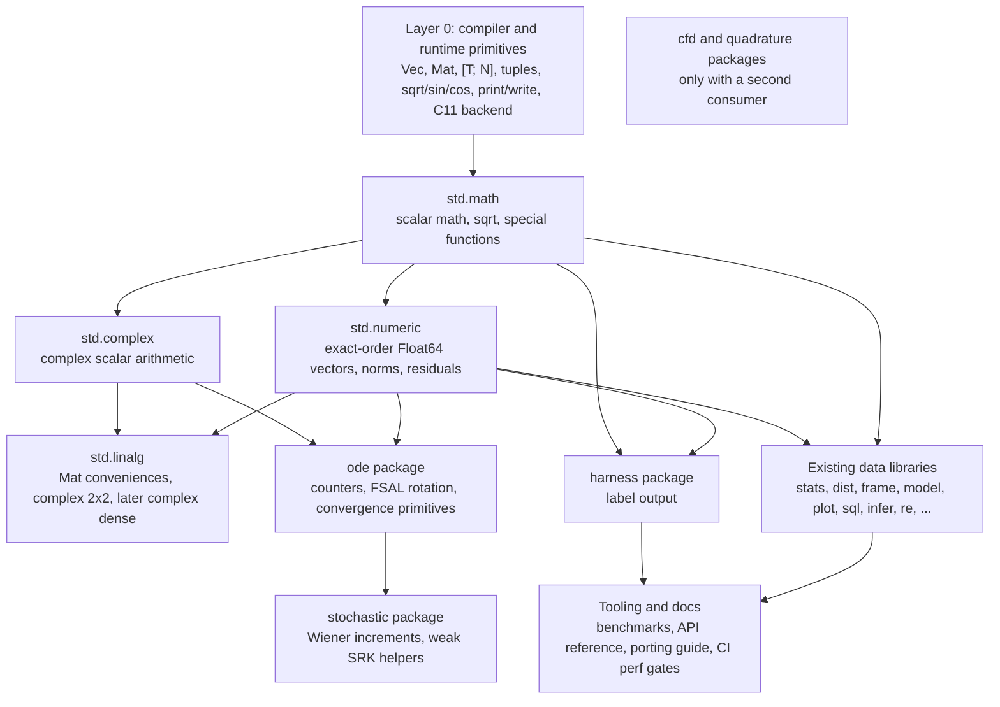

# 01 Ecosystem architecture

## 1. Design principles

The architecture follows six principles, in priority order.

1. **Evidence first.** A new module or API needs a port, a standard-library
   consumer, or a clear dependency that unlocks both. Hypothetical frameworks
   do not enter the core.
2. **Exactness is part of the interface.** Numerical functions document
   evaluation order, NaN, signed zero, and error behavior. The compiler and
   library may not silently reassociate arithmetic.
3. **Allocation is explicit.** A function name tells the caller whether it
   allocates. Hot loops use `_into` forms or fixed storage.
4. **Small core, broad reuse.** `std.*` holds stable, general-purpose
   capabilities. Domain solvers become packages.
5. **Compiler-backed where genericity is needed.** `Vec<T>` and `Mat` are
   compiler-instantiated. Generic collection operations belong there, not in
   a library that cannot express `T` yet.
6. **Compatibility by addition.** Existing names and behavior remain unless a
   documented defect requires a change. New APIs are additive.

## 2. Layered architecture



The arrows mean "may import". They do not mean "must import". A lower layer
never imports a higher layer. `std.math` must not depend on `std.numeric`.
`std.numeric` must not depend on `std.model` or `std.plot`. Domain packages may
depend on the core, but the core may not depend on a domain package.

## 3. Layer responsibilities

### Layer 0: compiler and runtime primitives

This layer owns operations that need type or layout knowledge:

- `Vec<T>` layout and methods.
- `Mat` layout and methods.
- Fixed arrays `[T; N]` and tuple returns, if implemented.
- Builtin scalar math that maps directly to C libm or compiler intrinsics:
  `sqrt`, `sin`, `cos`, `atan2`, and future guarded builtins.
- Ownership, borrow checking, drop, clone, move, and return conventions.
- C11 emission, compiler flags, runtime prelude, and print formatting.
- Bounds checks and any unchecked-index mechanism.
- Package and module resolution.

This layer must expose enough API that library code can be allocation aware
and exact. It must not grow domain-specific functions.

### Layer 1: core standard library

Layer 1 contains general mathematical and numerical building blocks:

| Module | Responsibility | Status |
| --- | --- | --- |
| `std.math` | Scalar math over `Float64`, with `Int64` parameters where relevant; `sqrt`, `exp`, `log`, `pow`, `abs`, `min`, `max`, rounding, `eps`, hyperbolic, `sincos`, `evalpoly` | Expand |
| `std.numeric` | Exact-order `Vec<Float64>` primitives, norms, scaled residuals, simple reductions | New |
| `std.complex` | Complex scalar arithmetic and functions over a `Complex` struct | Expand |
| `std.linalg` | Convenience and complex linear algebra that is not already a compiler `Mat` method | New, narrow |

The first version of `std.numeric` is concrete, not generic. It targets
`Vec<Float64>`. `Int32` and `Int64` variants are added only when a real
consumer needs them. This is a deliberate response to the lack of user-facing
generics.

### Layer 2: general data libraries

The existing modules remain where they are:

`std.stats`, `std.dist`, `std.frame`, `std.model`, `std.plot`, `std.sql`,
`std.infer`, `std.re`, `std.select`, `std.schema`, `std.validate`, `std.csv`,
`std.date`, `std.time`, `std.units`, `std.factor`, `std.missing`, `std.meta`,
`std.features`, `std.causal`, `std.autodiff`, `std.checked`, `std.provenance`,
`std.report`, `std.str`, `std.synth`, and `std.sys`.

These modules are not rebuilt in this plan. They are migrated to consume
`std.math` and `std.numeric` where that removes private duplication. This
keeps their public APIs stable and gives the new core immediate users.

### Layer 3: domain packages

Domain packages live outside `stdlib/` and use the existing manifest
dependency system. Proposed package names are tentative until the namespace
is settled:

| Package or tooling | Purpose | Trigger |
| --- | --- | --- |
| `ode` | ODE counter, FSAL rotation, convergence ratio, common residual adapters | At least two ODE ports or a native solver |
| `stochastic` | Wiener increment and `three_point_increment`; wider helpers later | Port 10 for the narrow v1; `Ihat2` and other helpers need a second weak-SDE consumer |
| `cfd` | Trixi log-mean, thermodynamic helpers, flux scaffolding | A second CFD port or shared native code |
| `quadrature` | Gridap quadrature containers and generated table helpers | A second Gridap port |
| `harness` | Label emission; oracle comparison stays in `VER-01` | After warning-free `println` output is stable; `write` is optional |
| `bench` tooling | Kernel benchmarks, allocation counters, codegen snapshots | Delivered by `TEST-01` |

The names `ode`, `stochastic`, and so on are module names. Manifest names can
be `valvet-ode` or `valvet_ode`; the exact mapping must follow the resolver's
rules when the first package is created. This is an open question, not a
blocker.

### Layer 4: tooling and documentation

This layer is not a library. It includes:

- A benchmark runner with JSON output and regression thresholds.
- Generated-C and disassembly snapshots for hot loops.
- A porting guide and template.
- Standard-library API reference generated from `pub` declarations.
- CI jobs for performance and codegen checks.
- Package discovery documentation for path and git dependencies.

## 4. Standard library versus package

The boundary is based on reuse and stability, not on difficulty.

| Capability | Location | Reason |
| --- | --- | --- |
| Scalar math | `std.math` | Used by every numeric domain |
| `Vec<Float64>` exact-order algebra | `std.numeric` | Used by at least six ports |
| Norms and scaled residuals | `std.numeric` | Used by five ports; stable formula |
| Complex scalar arithmetic | `std.complex` | Already exists; general purpose |
| Real matrix kernels | Compiler `Mat` | Already exists; layout dependent |
| Complex 2x2 solve | `std.linalg` | Narrow convenience; may grow |
| General complex dense linear algebra | `std.linalg` later | No current broad consumer |
| Fixed arrays and tuples | Compiler | Type and layout feature |
| ODE counters and FSAL rotation | `ode` package | Domain protocol, not general math |
| Weak SDE noise helpers | `stochastic` package | One current consumer |
| Trixi log-mean | `std.numeric` first; `cfd` only with a second CFD consumer | Two ports; scalar helper |
| Gridap quadrature containers | `quadrature` package | One port |
| Test label printer | `harness` package plus warning-free output | Test workflow, not production |
| Benchmarking | `bench` tooling in `TEST-01` plus CLI support | Workflow |

Do not add a public registry in the first phases. The manifest already
supports path and git dependencies with version bounds and a lockfile. The
ecosystem problem is not distribution yet; it is the absence of reusable
foundations.

## 5. Collection architecture

### 5.1 `Vec<T>`

`Vec<T>` remains a compiler-instantiated type. The following operations should
be added as compiler methods, not as `std.numeric` functions. The method syntax
below is illustrative; the semantics are the requirement.

```valvet
impl Vec<T> {
    pub fun with_capacity(n: Int64): Vec<T>
    pub fun reserve(v: &mut Vec<T>, n: Int64)
    pub fun resize(v: &mut Vec<T>, n: Int64, value: T)
    pub fun fill(v: &mut Vec<T>, value: T)
    pub fun copy_from(dst: &mut Vec<T>, src: &Vec<T>)
    pub fun capacity(v: &Vec<T>): Int64
}
```

The exact syntax may differ, but the semantics must be:

- `with_capacity(n)` allocates space for `n` elements and leaves `len == 0`.
- `reserve(n)` ensures room for `n` additional elements without changing
  `len`.
- `resize(n, value)` sets `len == n`, filling new slots with `value`.
- `fill(value)` sets every existing element to `value`.
- `copy_from(dst, src)` copies `src.len()` elements into `dst`, requiring
  `dst.len() >= src.len()`. It does not resize the destination.
- `capacity()` returns the allocated capacity.

Do not expose raw pointers or unchecked reallocation. The point is to remove
avoidable `realloc`, not to weaken safety.

### 5.2 Literals

Two forms are needed:

```valvet
vec![a, b, c]       // exact capacity 3, one allocation
vec![value; n]      // exact capacity n, one allocation, n copies
```

The existing `vec![...]` must allocate once, then fill, rather than push. The
repeat form must be added to the parser and codegen. For owned element types,
the repeat form either requires a clone function or is restricted to copy
types in its first version. That restriction is an open design question.

### 5.3 Fixed arrays and tuples

The preferred representation is compiler support:

```valvet
val p: [Float64; 2] = [x, y]
val q: (Float64, Float64) = (x, y)
```

Fixed arrays should:

- Store elements inline, with no heap allocation.
- Allow constant-index access without bounds checks when the index is proven
  in range.
- Support element assignment and a length known at compile time.
- Have clear copy and move behavior. If `Float64` is copyable, `[Float64; N]`
  should be copyable; owned element types must follow drop rules.
- Be usable as struct fields and function parameters without hidden
  allocation.

Tuple returns are needed for patterns such as `(z,)` and `(du, u)`. They
should be first-class values with destructuring and field access by position,
not a library of `Pair` structs.

If fixed arrays are not implemented in Phase 1, an interim `std.fixed` may
provide `Vec2`, `Vec3`, `Vec4`, and `Vec9` for ports 01 and 02. It must be
documented as a workaround and removed when compiler support lands. Do not
build a generic small-vector library on top of `Vec<T>`.

### 5.4 `Mat`

`Mat` is a real `Float64` matrix with substantial kernels:

`mat_zeros`, `mat_identity`, `mat_from_rows`, `transpose`, `outer`, `kron`,
`matmul`, `lu_solve`, `inverse`, `cholesky`, `scale_rows`, `mat_diag`,
`mat_col`, eigen, and SVD.

The missing operation is general mutable element access. Add methods on `Mat`:

```valvet
pub struct ShapeError { row: Int64, col: Int64, rows: Int64, cols: Int64 }

m.get(i: Int64, j: Int64): Option<Float64>
m.set(i: Int64, j: Int64, value: Float64): Result<Unit, ShapeError>
```

These are methods, not free functions; the call notation is illustrative. The
API must state row-major layout and bounds behavior. `ShapeError` carries the
offending index and the matrix dimensions. Do not add a second matrix type
until complex matrices are actually needed.

## 6. Numeric architecture

### 6.1 `std.math`

The first expansion covers the functions that the ports already hand-write:

```valvet
pub fun abs(x: Float64): Float64
pub fun min(a: Float64, b: Float64): Float64
pub fun max(a: Float64, b: Float64): Float64
pub fun floor(x: Float64): Float64
pub fun ceil(x: Float64): Float64
pub fun trunc(x: Float64): Float64
pub fun round(x: Float64): Float64
pub fun eps(x: Float64): Float64
pub fun sinh(x: Float64): Float64
pub fun cosh(x: Float64): Float64
pub fun tanh(x: Float64): Float64
pub fun acosh(x: Float64): Float64
pub fun asinh(x: Float64): Float64
pub fun atanh(x: Float64): Float64
pub fun sincos(x: Float64): (Float64, Float64)
pub fun hypot(x: Float64, y: Float64): Float64
pub fun ldexp(x: Float64, n: Int64): Float64
pub fun pow_int(x: Float64, n: Int64): Float64
pub fun clamp(x: Float64, lo: Float64, hi: Float64): Float64
pub fun evalpoly(x: Float64, coeffs: &Vec<Float64>): Float64
```

`sincos` returns a tuple, so it lands after ARR-02. Until tuple returns exist,
callers can use separate `sin` and `cos` calls or defer `sincos`.

`abs`, `min`, and `max` need explicit NaN and signed-zero tests before they
replace local shims. A naive `if (a < b) { a } else { b }` does not match
Julia `min` or `max` for NaN. `round` uses ties-to-even by default; a separate
rounding-mode API is out of scope for v1.

`sqrt` remains in `std.math` for explicit semantics, but the compiler also
recognizes `sqrt(x)` as a guarded builtin. The builtin fast path handles
positive values outside the tiny-normal band with C `sqrt`. The wrapper
handles negative, zero, NaN, infinity, and tiny normals. This preserves the
existing public contract while removing the software cost from ordinary code.

`exp`, `log`, and `pow` remain software functions for now. Their cost has not
been isolated in ports 01 and 02. A later task may add guarded libm lowering
after measurement.

### 6.2 `std.numeric`

`std.numeric` is a concrete library for `Vec<Float64>`. The first version:

```valvet
module std.numeric;

import std::math::sqrt;

pub fun zeros(n: Int64): Vec<Float64>
pub fun filled(n: Int64, x: Float64): Vec<Float64>
pub fun clone(v: &Vec<Float64>): Vec<Float64>
pub fun copy_from(dst: &mut Vec<Float64>, src: &Vec<Float64>)
pub fun fill(dst: &mut Vec<Float64>, x: Float64)
pub fun scale(a: Float64, x: &Vec<Float64>): Vec<Float64>
pub fun scale_into(dst: &mut Vec<Float64>, a: Float64, x: &Vec<Float64>)
pub fun axpy(a: Float64, x: &Vec<Float64>, b: Float64, y: &Vec<Float64>): Vec<Float64>
pub fun axpy_into(dst: &mut Vec<Float64>, a: Float64, x: &Vec<Float64>, b: Float64, y: &Vec<Float64>)
pub fun axpy3(a: Float64, x: &Vec<Float64>, b: Float64, y: &Vec<Float64>,
              c: Float64, z: &Vec<Float64>): Vec<Float64>
pub fun axpy3_into(dst: &mut Vec<Float64>, a: Float64, x: &Vec<Float64>,
                   b: Float64, y: &Vec<Float64>, c: Float64, z: &Vec<Float64>)
pub fun axpy4(a: Float64, x: &Vec<Float64>, b: Float64, y: &Vec<Float64>,
              c: Float64, z: &Vec<Float64>, d: Float64, w: &Vec<Float64>): Vec<Float64>
pub fun axpy4_into(dst: &mut Vec<Float64>, a: Float64, x: &Vec<Float64>,
                   b: Float64, y: &Vec<Float64>, c: Float64, z: &Vec<Float64>,
                   d: Float64, w: &Vec<Float64>)
pub fun dot(x: &Vec<Float64>, y: &Vec<Float64>): Float64
pub fun add(x: &Vec<Float64>, y: &Vec<Float64>): Vec<Float64>
pub fun sub(x: &Vec<Float64>, y: &Vec<Float64>): Vec<Float64>
pub fun sum(x: &Vec<Float64>): Float64
pub fun mean(x: &Vec<Float64>): Float64
pub fun min_vec(x: &Vec<Float64>): Float64
pub fun max_vec(x: &Vec<Float64>): Float64
pub fun sum_sq(x: &Vec<Float64>, c: Float64): Float64
pub fun sd(x: &Vec<Float64>): Float64
pub fun norm2(x: &Vec<Float64>): Float64
pub fun rms(x: &Vec<Float64>): Float64
pub fun rms_parts(a: &Vec<Float64>, b: &Vec<Float64>): Float64
pub fun scaled_residual(x: &Vec<Float64>, u0: &Vec<Float64>, u1: &Vec<Float64>,
                        alpha: Float64, rho: Float64): Vec<Float64>
pub fun scaled_residual2(x: &Vec<Float64>, u0a: &Vec<Float64>, u1a: &Vec<Float64>,
                         u0b: &Vec<Float64>, u1b: &Vec<Float64>,
                         alpha: Float64, rho: Float64): Vec<Float64>
pub fun log_mean(x: Float64, y: Float64): Float64
pub fun inv_log_mean(x: Float64, y: Float64): Float64
```

That is a large surface. Implementation is staged:

- P0: `zeros`, `filled`, `clone`, `copy_from`, `fill`, `scale`, `scale_into`,
  `axpy`, `axpy_into`, `axpy3`, `axpy3_into`, `axpy4`, `axpy4_into`, `dot`,
  `norm2`, `rms`, `rms_parts`, `scaled_residual`, `scaled_residual2`.
- P1: `add`, `sub`, `sum`, `mean`, `min_vec`, `max_vec`, `sum_sq`, and `sd`.
  These have existing standard-library consumers, so they land with NUM-03
  after the P0 contract is stable.
- P2: `log_mean` and `inv_log_mean`.

The simple reductions and elementwise helpers enter `std.numeric` only when
the stdlib consolidation task begins, not in the first P0 batch.

Allocation and length rules:

- Allocating forms return exactly the input length. `_into` forms write into a
  caller-owned destination, require `dst.len()` to match the result length,
  and do not resize or allocate.
- `copy_from` requires `dst.len() >= src.len()` and does not resize `dst`.
  `fill` writes existing elements.
- Binary helpers require equal-length inputs, except `rms_parts`, whose
  two-part mismatch policy is pinned by `NUM-02`. In v1 a mismatch is a
  documented precondition, not a `Result`.

Exact-order rules:

- `axpy` and `axpy_into` compute `a*x[i] + b*y[i]` with two multiplies and one add.
- `axpy3`, `axpy3_into`, `axpy4`, and `axpy4_into` preserve left-associative
  source grouping.
- `add` and `sub` compute one elementwise operation in increasing index order and
  require equal-length inputs.
- `sum`, `mean`, `sum_sq`, and `sd` accumulate in increasing index order.
  `sum` and `sum_sq` return `0.0` for empty input. `mean` sums first, then
  divides by `n`; empty input gives NaN. `sum_sq` computes
  `(x[i] - c) * (x[i] - c)`. `sd` uses the sample denominator `n - 1` and
  returns `0.0` when `n < 2`, matching the current plot helper.
- `min_vec` and `max_vec` seed with element 0 and update only on a strict
  comparison, matching the current `fmin`/`fmax` order. They require non-empty
  input. NaN and signed-zero behavior is pinned by tests before publication.
- `rms` sums in increasing index order, divides by `n`, then calls `sqrt`.
- `rms_parts` sums all of part 1, then all of part 2, then computes
  `sqrt((s1 + s2) / (n1 + n2))`.
- `scaled_residual` computes
  `x[i] / (alpha + max(abs(u0[i]), abs(u1[i])) * rho)`.
- No function uses `fma`, reassociation, or a different summation order.

### 6.3 `std.complex`

`std.complex` is already sufficient for port 09's arithmetic. The plan adds:

- Value-taking wrappers if borrow syntax is noisy at broadcast sites:
  `cadd_v`, `csub_v`, `cmul_v`, `cdiv_v`.
- `pow_int` is a general scalar function and belongs in `std.math`, not a new
  complex module.
- A documented statement that `cdiv` keeps the simple formula. A future
  overflow-safe division is `cdiv_robust`, not a behavior change to `cdiv`.
- A complex 2x2 solve wrapper in `std.linalg` only when the port is migrated.

Do not add a second complex type. Do not add a builtin `Complex` scalar until
a second consumer needs C99 `_Complex`.

### 6.4 `std.linalg`

The first version is intentionally small:

- `Mat` element get/set is a compiler change, not a library wrapper.
- A complex 2x2 solve that preserves the oracle's real-arithmetic formulas.
- Convenience wrappers only where the existing `Mat` API is awkward.
- No BLAS, no LAPACK binding, no general dense complex matrix, no generic
  matrix type.

A general complex matrix becomes justified only when an implicit FIRK or
extrapolation port is attempted. The current Radau3 port needs one 2x2 solve.

## 7. Package architecture

### 7.1 `ode`

The `ode` package should export protocol primitives, not a solver:

```valvet
pub struct OdeStatus {
    nf: Int64,
    nsolve: Int64,
    nnonliniter: Int64,
}

pub fun increment_nf(s: &mut OdeStatus, n: Int64)
pub fun rotate_fsal(fsa: &mut Vec<Float64>, fsb: &mut Vec<Float64>)
pub fun convergence_ratio(ndw: Float64, ndwprev: Float64): Float64
```

The package may also re-export the `std.numeric` norm and residual adapters.
It must not hide the ConstantCache versus mutable-cache `nf` asymmetry. Ports
07, 08, and 09 all reproduce an upstream behavior where the final `fsallast`
evaluation is not counted for ConstantCache. A generic `increment_nf` helper
must remain a visible call, not an automatic side effect of every RHS
evaluation.

### 7.2 `stochastic`

The `stochastic` package gets a narrow v1 from port 10, the only current
weak-SDE consumer. Wider helpers wait for a second consumer:

```valvet
pub struct Wiener { dW: Vec<Float64>, dZ: Vec<Float64>, sqdt: Float64 }
pub fun three_point_increment(sq3dt: Float64, quantile: Float64, dW_scaled: Float64): Float64
```

Two-point and diagonal-noise helpers are not part of v1. Add them only from a
second consumer.

The scalar and vector branches must remain separate. Port 10's nested predicate
and negative quantile are part of the numerical contract.

### 7.3 `cfd` and `quadrature`

Do not create these packages from one port. Keep the helpers local until a
second port or native application needs them. The only near-term cross-port
candidate is Trixi's `ln_mean` and `inv_log_mean`, used 20 and 8 times across
ports 01 and 02. They can enter `std.numeric` in P2 with the exact polynomial
branch and `evalpoly` behavior.

### 7.4 `harness` and benchmark tooling

These are workflow components, not production dependencies. The harness is a
small optional package; it can remain a repository script until independent
versioning is needed. It depends on warning-free `println` output; `write` is
optional and is not part of the three-line oracle protocol. Benchmark tooling
is delivered by `TEST-01` and depends on a stable `valvet build` and a JSON
result format. Benchmark tooling stays in `TEST-01`. Neither belongs in
`std.*`.

## 8. API conventions

### 8.1 Naming

- Use lower_snake_case for functions and fields.
- Use CamelCase for types.
- Use `_new` for constructors, `_into` for in-place writes, `_parts` for
  multi-part state, and `_robust` for numerically safer alternatives that
  intentionally change rounding.
- Keep existing names. Do not rename `std.math.sqrt` to `std.math.square_root`.
- Prefer `Float64` in public numeric signatures unless an integer overload is
  genuinely needed.
- Avoid abbreviations that are not already standard in the codebase. `axpy`
  is accepted because it is the established BLAS name and the ports use it.
  `ndz` is not a public name.

### 8.2 Allocation

- A function without `_into` may allocate. Document whether it allocates once
  or per element.
- A function with `_into` must not allocate for fixed-size inputs. If it may
  resize, document that.
- Constructors such as `zeros` and `filled` allocate exactly once.
- `clone` uses the existing `Vec.clone` runtime, not a push loop.
- No library function hides an unbounded temporary inside a hot loop.

### 8.3 Error behavior

- Shape-checked APIs return `Result<_, ShapeError>`, or `Option` for a read
  accessor such as `Mat.get`; they do not abort.
- Exact-order vector primitives document equal-length preconditions and do not
  return `Result` in hot loops. A checked wrapper may be added later.
- Scalar domain errors follow the existing math contract: negative `sqrt`
  gives NaN, `log(0)` gives negative infinity, NaN propagates.
- A function that cannot represent an error in its type documents the
  precondition and uses a debug assertion only if the compiler has one. Do not
  silently return a wrong value.
- `min` and `max` define NaN and signed-zero behavior in tests before they are
  public.

### 8.4 Borrowing

- Read-only vector arguments use `&Vec<Float64>`.
- Output arguments use `&mut Vec<Float64>`.
- Returned vectors are owned.
- Do not require `&mut` for a function that only reads.
- Do not take a vector by value unless ownership transfer is the point.
- Avoid APIs that force a caller to bind a temporary solely to satisfy the
  borrow checker. If that remains common, the language work in DX-03 is the
  fix, not a proliferation of value-taking wrappers.

### 8.5 Compatibility

- Additive changes are preferred.
- Existing `Vec.add`, `Vec.mul`, `Vec.add_scalar`, and `Vec.dot` keep their
  behavior and `Result` types.
- `std.math.sqrt` keeps its negative, zero, NaN, and infinity behavior; only
  the tiny-normal last bit may change as a bug fix.
- `std.complex.cdiv` keeps the simple formula.
- `print` remains a deprecated alias of `println`; new code uses `println`
  for lines and `write` for deliberate no-newline output.
- Deprecations require a replacement, a migration note, and a fixture that
  proves the replacement output is identical.

## 9. Compiler and library boundary

Some tasks look like library work but must start in the compiler:

| Capability | Why compiler | Library consequence |
| --- | --- | --- |
| `Vec.with_capacity` | Needs layout and allocation knowledge | `std.numeric.zeros` allocates once |
| Repeat literal | Parser and codegen change | No push loop for `vec![x; n]` |
| Fixed arrays | Type system and layout | Removes `V2`/`V4`/`V9` workarounds |
| Tuple returns | Type system and ABI | Removes `Pair` structs |
| `Mat` get/set | Layout and bounds behavior | Port 03 can use `Mat` |
| Guarded `sqrt` | Codegen intrinsic | Removes software call from hot paths |
| Literal contextual typing | Sema change | Removes `as Int64` noise |
| Output API | Builtin or stdlib IO | `println` removes W1002; `write` adds no-newline output |
| Function sections | Build flags | Halves dev text size |
| Bounds-check elision | Codegen analysis or explicit `@inbounds` | Fixed-index access gets cheaper |

If a library task depends on one of these, the compiler task moves earlier.
The roadmap reflects that dependency order.

## 10. Architecture decisions to record

These are proposed ADRs for the implementation phases:

- **ADR-L1:** `std.numeric` is concrete `Float64` first; no generic user
  library until monomorphization exists.
- **ADR-L2:** `Vec<T>` allocation and capacity APIs are compiler methods, not
  free functions.
- **ADR-L3:** `std.math.min` and `max` define and test NaN and signed-zero
  behavior before adoption; the contract is not copied blindly from Julia or C.
- **ADR-L4:** `sqrt` is both a `std.math` function and a guarded compiler
  builtin; the library keeps edge-case semantics.
- **ADR-L5:** `std.numeric` preserves left-to-right exact evaluation order and
  forbids FMA and reassociation.
- **ADR-L6:** `Mat` remains the only real matrix type; no `Matrix<T>` until
  fixed arrays and generics exist.
- **ADR-L7:** domain solvers are packages, not `std.*`, until multiple
  independent consumers exist.
- **ADR-L8:** no public package registry in the first phases; use path and git
  dependencies.
- **ADR-L9:** `print` migrations use `println` for lines and `write` for
  deliberate no-newline output; `print` is not silently un-deprecated without
  a migration plan.
- **ADR-L10:** performance claims require measured or codegen evidence, and
  `-O3` remains opt-in.

## 11. What this architecture deliberately does not do

- It does not create a universal array or tensor abstraction.
- It does not create a generic iterator framework.
- It does not create an ODE solver framework.
- It does not move all existing stdlib modules into packages.
- It does not make `std.numeric` generic before the language supports it.
- It does not add complex linear algebra before a consumer exists.
- It does not assume fewer source lines means better machine code.
- It does not weaken the bit-exact contract for convenience.
