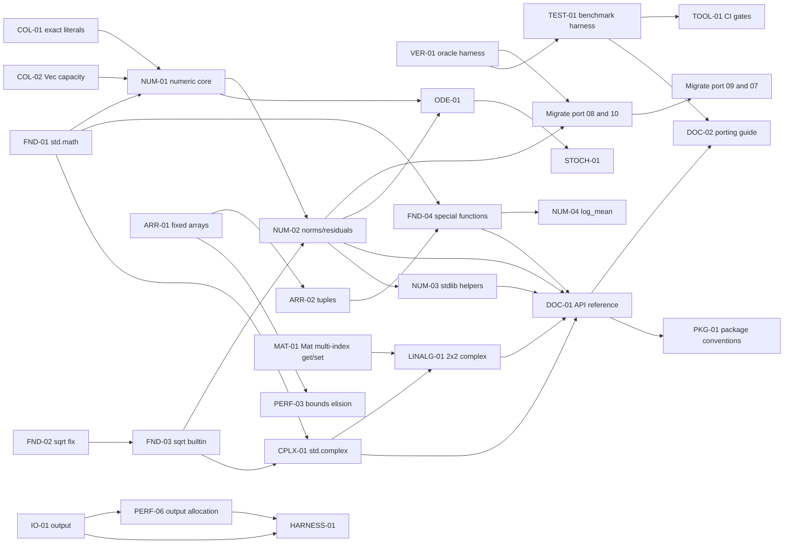

# 05 Implementation roadmap

## 1. Ordering logic

The order is driven by four rules:

1. Fix capabilities that block multiple libraries before adding libraries.
2. Prove each library on the smallest bit-exact port before broad migration.
3. Do not start a domain package until the core it depends on is stable.
4. Move compiler work earlier when a library cannot meet its performance or
   allocation contract without it.

This produces a critical path through `std.math`, collection allocation,
`std.numeric`, oracle verification, and only then fixed arrays, packages, and
higher-level tooling.

Effort uses the audit scale:

- **S**: one focused change, usually one file plus tests.
- **M**: a multi-file library or compiler change plus tests.
- **L**: compiler or language work, or a cross-cutting migration.

No calendar estimates are given. The repository does not have measured
porting-velocity data, and inventing dates would be misleading.

Each phase task table has an `Exact File Changes Required` column. It
lists the repository paths. The exact symbols, edits, sources, completion
checks, and risks are in [the detailed table](06_actionable_task_list.md#exact-file-changes-required).
Current per-task status and evidence live in
[09_completion_status.md](09_completion_status.md); the phase tables below
remain the planned scope, not a completion report.
The two views must not disagree; if they do, the detailed table in `06` is
authoritative.

## 2. Phase 0: foundations and quick wins

### Intended outcome

A trusted scalar math foundation, allocation-aware vector primitives, a
warning-free output path, and a repeatable oracle harness. After Phase 0, a
port can stop carrying local `sqrt`, `abs`, `zeros`, `clone`, `axpy`, and
residual helpers for the covered operations.

### Tasks

| Task | Title | Effort | Critical path | Exact File Changes Required |
| --- | --- | --- | --- | --- |
| FND-01 | Expand `std.math` scalar foundation | M | Yes | Create `valvet-tests/compile-pass/math_scalar.valvet` and `.stdout`; modify `stdlib/math.valvet`. |
| FND-02 | Fix `sqrt` for tiny normals | S | Yes | Create `scripts/sqrt_sweep.py`, `valvet-tests/compile-pass/math_sqrt_tiny.valvet` and `.stdout`; modify `stdlib/math.valvet` only if the sweep fails. |
| FND-03 | Guarded `sqrt` builtin and FP flags | M | Yes | Create `crates/valvet_core/tests/codegen_fp.rs`, `valvet-tests/compile-pass/sqrt_builtin.valvet` and `.stdout`; modify `crates/valvet_core/src/sema.rs`, `crates/valvet_core/src/codegen.rs`. |
| COL-01 | Exact `vec![...]` and repeat literal | M | Yes | Create `valvet-tests/compile-pass/vec_repeat.valvet` and `.stdout`, `valvet-tests/compile-pass/vec_literal_owned.valvet` and `.stdout`; modify `crates/valvet_core/src/ast.rs`, `crates/valvet_core/src/parser.rs`, `crates/valvet_core/src/sema.rs`, `crates/valvet_core/src/codegen.rs`. |
| COL-02 | `Vec` capacity, reserve, resize, fill, copy | M | Yes | Create `valvet-tests/compile-pass/vec_capacity.valvet` and `.stdout`, `valvet-tests/compile-pass/vec_owned_ops.valvet` and `.stdout`, `valvet-tests/compile-fail/vec_copy_from_short.valvet` and `.error`; modify `crates/valvet_core/src/ast.rs`, `crates/valvet_core/src/parser.rs`, `crates/valvet_core/src/sema.rs`, `crates/valvet_core/src/codegen.rs`. |
| COL-03 | Ordered string-keyed index | M | No | Create `docs/implementation/DICT_SPEC.md`, front-end tests, seven compile-pass and seven compile-fail fixtures with sidecars; modify `crates/valvet_core/src/ast.rs`, `crates/valvet_core/src/parser.rs`, `crates/valvet_core/src/sema.rs`, `crates/valvet_core/src/ownership.rs`, `crates/valvet_core/src/codegen.rs`; update `README.md`, `docs/implementation/ARCHITECTURE.md`, and roadmap/status docs. See `docs/implementation/DICT_SPEC.md` for exact changes. |
| NUM-01 | `std.numeric` exact-order vector core | M | Yes | Create `stdlib/numeric.valvet`, `valvet-tests/compile-pass/numeric_core.valvet` and `.stdout`. |
| NUM-02 | `std.numeric` norms and scaled residuals | S | Yes | Modify `stdlib/numeric.valvet`; create `valvet-tests/compile-pass/numeric_residuals.valvet` and `.stdout`. |
| IO-01 | Warning-free output and no-newline `write` | M | No | Create `valvet-tests/compile-pass/write_no_newline.valvet` and `.stdout`; modify `crates/valvet_core/src/sema.rs`, `crates/valvet_core/src/codegen.rs`. |
| PERF-01 | Dev function/data sections and gc | S | No | Create `crates/valvet_core/tests/codegen_fp.rs`; modify `crates/valvet_core/src/codegen.rs` (`cc_build_profile`, new `cc_flags`). |
| DX-01 | Integer literal contextual inference | L | No | Create `valvet-tests/compile-pass/literal_context.valvet` and `.stdout`, `valvet-tests/compile-fail/literal_narrowing.valvet` and `.error`; modify `crates/valvet_core/src/sema.rs`, `crates/valvet_core/tests/front_end.rs`. |
| DX-02 | Accept dotted import spelling | S | No | Modify `crates/valvet_core/src/parser.rs`, `valvet-tests/multi-file/dotted/main.valvet`; add `valvet-tests/multi-file/dotted/math.valvet` and `valvet-tests/multi-file/dotted/main.valvet.stdout`; delete `valvet-tests/multi-file/dotted/main.valvet.error`; add `valvet-tests/multi-file/dotted-std/main.valvet` and `valvet-tests/multi-file/dotted-std/main.valvet.stdout`. |
| VER-01 | Port oracle harness | M | Yes | Create `scripts/compare_oracles.py`, `scripts/oracle_schema.json`, `scripts/README.md`, `scripts/tests/test_compare_oracles.py`; no repository oracle data. |

### Prerequisites

- Existing gates pass on the current tree.
- The uncommitted compiler batch is either committed or explicitly treated as
  the baseline; do not stack unrelated compiler work on an unverified tree.
- The port working artifacts and oracles are available outside the repository.

### Risks

- `sqrt` edge cases and tiny normals.
- Exact literal allocation for owned types.
- Literal inference is broad and can change overload resolution.
- Using `write` for the three-line label protocol would change output; migrate
  those calls to `println`.
- `std.numeric` can accidentally allocate in hot loops.

### Exit criteria

- `std.math` scalar functions pass NaN, signed-zero, zero, infinity, and
  subnormal tests.
- `sqrt` is bit-exact against a 1,000,000-value tiny-normal sweep and the
  existing edge cases.
- Emitted C uses a guarded hardware/libm `sqrt` on the safe positive path.
- `vec![...]` allocates exactly once; `vec![value; n]` exists for copy types.
- `Vec.with_capacity`, `reserve`, `resize`, `fill`, and `copy_from` pass
  allocation, drop, and ASan tests.
- Port 08 migrates its vector helpers with 280/280 labels bit-exact; port 10
  migrates the shared math path with 328/328 labels bit-exact.
- Port 07 label output remains exactly 31,122 lines when exercised through the
  existing printer.
- New harness code compiles with no W1002.
- Contextual integer inference passes comparison, assignment, argument, and loop
  fixtures with no ambiguity.
- Both `std::math::sqrt` and `std.math::sqrt` import forms compile, and
  duplicate imports do not double-load.
- Dev text size drops by at least 40 percent on BDF and weak.
- All repository gates pass.

### Phase 0 verification

- `valvet test valvet-tests` debug and release.
- New math fixtures and tiny-normal sweep.
- Import-spelling and integer-literal inference fixtures.
- Port 08 and port 10 oracle comparison.
- Generated C `<error>` count zero.
- ASan/UBSan/LSan clean.
- Allocation counters before and after.
- BDF and FIRK warm numeric loops for `sqrt`.
- `cargo fmt`, clippy, and unit tests.

## 3. Phase 1: core library improvements

### Intended outcome

A stable core numeric API, adoption of existing complex and matrix
capabilities, and the first language work that removes representation
workarounds.

### Tasks

| Task | Title | Effort | Critical path | Exact File Changes Required |
| --- | --- | --- | --- | --- |
| FND-04 | Math special functions (`sincos`, `hypot`, `ldexp`, `evalpoly`) | M | No | Modify `stdlib/math.valvet`; create `valvet-tests/compile-pass/math_special.valvet` and `.stdout`. |
| CPLX-01 | Adopt `std.complex` in port 09 | S | Yes | No `stdlib/complex.valvet` change confirmed; create `valvet-tests/compile-pass/complex_pow.valvet` and `.stdout`. Port 09 source is external and not in this checkout. |
| NUM-03 | Consolidate private stdlib vector/scalar helpers | M | No | Modify `stdlib/model.valvet`, `stdlib/plot.valvet`, `stdlib/infer.valvet`, `stdlib/numeric.valvet`; add `valvet-tests/compile-pass/numeric_reductions.valvet` and `.stdout`. |
| ARR-01 | Fixed arrays `[T; N]` | L | Yes | Create `valvet-tests/compile-pass/fixed_array_basic.valvet` and `.stdout`, `valvet-tests/compile-pass/fixed_array_owned.valvet` and `.stdout`, `valvet-tests/compile-fail/fixed_array_len_mismatch.valvet` and `.error`; modify `crates/valvet_core/src/ast.rs`, `crates/valvet_core/src/parser.rs`, `crates/valvet_core/src/sema.rs`, `crates/valvet_core/src/ownership.rs`, `crates/valvet_core/src/codegen.rs`, `docs/implementation/ARCHITECTURE.md`. |
| ARR-02 | Tuple returns and destructuring | L | Yes | Create `valvet-tests/compile-pass/tuple_return.valvet` and `.stdout`, `valvet-tests/compile-pass/tuple_owned.valvet` and `.stdout`, `valvet-tests/compile-fail/tuple_arity.valvet` and `.error`; modify `crates/valvet_core/src/ast.rs`, `crates/valvet_core/src/parser.rs`, `crates/valvet_core/src/sema.rs`, `crates/valvet_core/src/ownership.rs`, `crates/valvet_core/src/codegen.rs`. |
| ARR-03 | Runtime-rank N-dimensional arrays `ArrayD<T>` | M | No | Create the `arrayd_*` compile-pass and compile-fail fixtures; modify `crates/valvet_core/src/parser.rs`, `crates/valvet_core/src/sema.rs`, `crates/valvet_core/src/ownership.rs`, `crates/valvet_core/src/codegen.rs`, `crates/valvet_core/tests/front_end.rs`, `docs/implementation/ARCHITECTURE.md`. |
| ARR-04 | Compile-time-rank arrays `Array<T, N>` | L | No | Create `array_fixed_*` fixtures; modify `crates/valvet_core/src/ast.rs`, `crates/valvet_core/src/parser.rs`, `crates/valvet_core/src/sema.rs`, `crates/valvet_core/src/ownership.rs`, `crates/valvet_core/src/codegen.rs`, `docs/implementation/ARCHITECTURE.md`. |
| MAT-01 | `Mat` multi-index get/set | M | No | Create `valvet-tests/compile-pass/mat_get_set.valvet` and `.stdout`, `valvet-tests/compile-pass/mat_index_oob.valvet` and `.exit`; create `valvet-tests/compile-fail/mat_index_arity.valvet` and `.error`, `valvet-tests/compile-fail/mat_index_type.valvet` and `.error`, `valvet-tests/compile-fail/vec_index_arity.valvet` and `.error`; modify `crates/valvet_core/src/ast.rs`, `crates/valvet_core/src/parser.rs`, `crates/valvet_core/src/resolver.rs`, `crates/valvet_core/src/sema.rs`, `crates/valvet_core/src/ownership.rs`, `crates/valvet_core/src/codegen.rs`, `crates/valvet_core/tests/front_end.rs`. |
| LINALG-01 | Complex 2x2 solve wrapper | S | Yes | Create `stdlib/linalg.valvet`, `valvet-tests/compile-pass/linalg_complex2.valvet` and `.stdout`. Port 09 source is external. |
| PERF-02 | Inline-friendly `Vec` kernels | M | Yes | Modify `crates/valvet_core/src/codegen.rs` (`emit_adts` prototype block, `emit_vec_fns`, `emit_vec_method`); add assertions to `crates/valvet_core/tests/codegen_fp.rs`. |
| PERF-03 | Constant-index bounds elision or `@inbounds` | L | No | Create `valvet-tests/compile-pass/inbounds_array.valvet` and `.stdout`, `valvet-tests/compile-fail/inbounds_outside_fn.valvet` and `.error`; modify `crates/valvet_core/src/ast.rs`, `crates/valvet_core/src/parser.rs`, `crates/valvet_core/src/sema.rs`, `crates/valvet_core/src/ownership.rs`, `crates/valvet_core/src/codegen.rs`. |
| PERF-06 | Literal print fast path and peephole | M | No | Create `valvet-tests/compile-pass/print_literal_alloc.valvet` and `.stdout`; modify `crates/valvet_core/src/codegen.rs` (`emit_block_body_only`, print branch). |
| DX-03 | Borrow and temporary lifetime ergonomics | L | No | Create `valvet-tests/compile-pass/borrow_temp_let.valvet` and `.stdout`, `valvet-tests/compile-fail/borrow_temp_escape.valvet` and `.error`; move `valvet-tests/compile-fail/borrow_temp.valvet` and `.error` to `valvet-tests/compile-pass/borrow_temp.valvet` and `.stdout`; modify `crates/valvet_core/src/ownership.rs`, `crates/valvet_core/src/sema.rs`, `crates/valvet_core/src/codegen.rs`. |
| DX-04 | Diagnostic quality pass | M | No | Create `valvet-tests/compile-fail/diag_arity.valvet` and `.error`, `valvet-tests/compile-fail/diag_borrow_site.valvet` and `.error`, `valvet-tests/compile-fail/diag_redundant_cast.valvet` and `.error`; modify `crates/valvet_core/src/diag.rs`, `crates/valvet_core/src/pipeline.rs`, `crates/valvet_core/src/sema.rs`, `crates/valvet_core/tests/front_end.rs`. |
| TEST-01 | Benchmark and codegen snapshot harness | M | Yes | Create `crates/valvet_cli/src/bench.rs`, `scripts/alloc_count.c`, `scripts/compare_bench.py`, `benchmarks/kernels/axpy.valvet` and `.stdout`; modify `crates/valvet_cli/src/main.rs`. |

### Prerequisites

- Phase 0 exit criteria met.
- `std.numeric` P0 has at least two passing port migrations.
- Fixed-array design has an ABI and copy/move decision.
- Borrow changes have a soundness review.

### Risks

- Fixed arrays and tuple returns can destabilize codegen and ABI.
- Bounds-check elision can remove safety without a proof.
- Borrow changes can create unsound programs.
- `PERF-02` can increase code size.
- Complex wrappers can introduce copies.

### Exit criteria

- Ports 08 and 09 still pass after the NUM-03 standard-library migration.
- Port 09 imports `std.complex` and removes `C09` with 332/332 labels.
- The standard library has no private duplicate of a public `std.numeric` or
  `std.math` helper that can be migrated without behavior change.
- `[Float64; 2]` and tuple returns compile, run, and pass drop/borrow tests.
- `Mat.get/set` works without flattening in a focused fixture and a port 03
  reconstruction spike.
- `std.linalg` complex 2x2 matches port 09 bit-exactly.
- `sincos`, `hypot`, `ldexp`, and `evalpoly` pass focused fixtures, including
  Horner order and extreme exponents.
- Benchmark harness reports time, allocations, size, and oracle status in JSON.
- Port 07 output remains 31,122 lines after PERF-06, with fewer label
  allocations.
- All gates pass.

### Phase 1 verification

- Port 07, 08, and 09 oracle runs.
- Port 01 and 02 focused fixed-vector fixtures, since their full sources are
  not retained.
- Generated-C review for `axpy`, `rms`, and fixed arrays.
- ASan/UBSan/LSan.
- `cargo test` and fixtures.
- Benchmark baseline for every changed kernel.

## 4. Phase 2: higher-level packages

### Intended outcome

Domain and workflow packages that are proven by real ports, without turning
the standard library into a solver framework.

### Tasks

| Task | Title | Effort | Critical path | Exact File Changes Required |
| --- | --- | --- | --- | --- |
| ODE-01 | `ode` package counters, FSAL, convergence, norm adapters | M | No | Create `packages/ode/valvet.toml`, `packages/ode/ode.valvet`, `packages/ode/README.md`, `valvet-tests/multi-file/ode-package/valvet.toml`, `valvet-tests/multi-file/ode-package/main.valvet`, `valvet-tests/multi-file/ode-package/main.valvet.stdout`. |
| HARNESS-01 | `harness` package label emitter | S | No | Create `packages/harness/valvet.toml`, `packages/harness/harness.valvet`, `packages/harness/README.md`, `valvet-tests/multi-file/harness-package/valvet.toml`, `valvet-tests/multi-file/harness-package/main.valvet`, `valvet-tests/multi-file/harness-package/main.valvet.stdout`. |
| STOCH-01 | `stochastic` package weak SRK helpers | M | No | Create `packages/stochastic/valvet.toml`, `packages/stochastic/stochastic.valvet`, `packages/stochastic/README.md`, `valvet-tests/multi-file/stochastic-package/valvet.toml`, `valvet-tests/multi-file/stochastic-package/main.valvet`, `valvet-tests/multi-file/stochastic-package/main.valvet.stdout`; defer the body until the port 10 helper is recovered. |
| NUM-04 | Trixi `log_mean` and `inv_log_mean` | S | No | Modify `stdlib/numeric.valvet`; create `valvet-tests/compile-pass/log_mean.valvet` and `.stdout`; requires Trixi source recovery. |

### Prerequisites

- Phase 1 exit criteria met.
- A second consumer exists for any package that is not already justified.
- The warning-free output API is stable; `write` is optional for the harness.
- The ODE counter semantics, especially ConstantCache versus mutable cache,
  are documented in tests.

### Risks

- Premature abstraction with one consumer.
- Hiding algorithm-specific counter behavior.
- Package namespace and module naming are unresolved.
- Domain packages can drift from the core and recreate helpers.

### Exit criteria

- `ode` primitives are used by at least two ports without changing labels.
- `harness` preserves W1002-free output and removes duplicate label code from
  at least one port.
- `stochastic` is created only for the confirmed port 10 consumer; wider helpers
  require a second concrete consumer.
- `log_mean` and `inv_log_mean` pass ports 01 and 02 or a reconstructed
  fixture, with the exact polynomial branch.
- No domain package is imported by `std.math`, `std.numeric`, `std.complex`, or
  `std.linalg`.

## 5. Phase 3: performance and compiler integration

### Intended outcome

Close the remaining measured codegen gaps and make library use cheap in hot
loops without weakening exactness or safety.

### Tasks

| Task | Title | Effort | Critical path | Exact File Changes Required |
| --- | --- | --- | --- | --- |
| PERF-04 | Large aggregate by pointer or move elision | L | No | Create `docs/implementation/PORT-PERF-04.md`, `valvet-tests/compile-pass/large_state_borrow.valvet` and `.stdout`; change port 07 source outside this repository. |
| PERF-05 | Optional `-O3` profile | S | No | Modify `crates/valvet_core/src/codegen.rs` (`cc_build_profile`, new `cc_flags`), `crates/valvet_cli/src/main.rs` (help and profile validation), `docs/implementation/IMPLEMENTATION_STATUS.md`; add flag assertions to `crates/valvet_core/tests/codegen_fp.rs`. |
| PERF-02 follow-up | Inline and code-size tuning | M | No | Modify `crates/valvet_core/src/codegen.rs`; extend `crates/valvet_core/tests/codegen_fp.rs`. |
| PERF-03 follow-up | Bounds-check proof and `@inbounds` hardening | L | No | Modify `crates/valvet_core/src/codegen.rs` proof helper and `crates/valvet_core/src/ownership.rs` tests; add `valvet-tests/compile-pass/inbounds_proof.valvet` and `.stdout`. |
| PERF-06 follow-up | Print buffering and allocation review | M | No | Modify `crates/valvet_core/src/codegen.rs` print buffering; extend `valvet-tests/compile-pass/print_literal_alloc.valvet`. |

### Prerequisites

- Phase 1 and 2 measurements exist.
- A benchmark baseline is checked in.
- The exactness contract tests cover every changed path.

### Risks

- Compiler changes can regress unrelated code.
- `-O3` can grow binaries and change reproducibility.
- Large-aggregate ABI changes are invasive.
- Bounds-check elision can hide a real out-of-bounds bug.

### Exit criteria

- Port 07's 536-byte per-step state copy is removed or shown not to matter on
  a long run.
- Optional `-O3` profile is documented with size and speed data; default stays
  `-O2`.
- Inline changes do not increase default binary size by more than 5 percent
  without an explicit decision.
- Bounds-check changes preserve ASan behavior and do not remove checks
  globally.
- No implicit FMA contraction or reassociation appears in exact-order paths.
  Packed instructions are acceptable only when each lane preserves the
  documented order and rounding.

## 6. Phase 4: ecosystem and developer experience

### Intended outcome

A discoverable, repeatable workflow for writing and porting Valvet code.

### Tasks

| Task | Title | Effort | Critical path | Exact File Changes Required |
| --- | --- | --- | --- | --- |
| DOC-01 | Standard-library API reference | M | No | Create `docs/stdlib/README.md`, `docs/stdlib/math.md`, `docs/stdlib/numeric.md`, `docs/stdlib/complex.md`, `docs/stdlib/linalg.md`, `scripts/check_stdlib_docs.py`, `examples/numeric_core.valvet` and `examples/numeric_core.valvet.stdout`. |
| DOC-02 | Porting guide and project template | M | No | Create `docs/porting/README.md`, `docs/porting/ORACLE.md`, `docs/porting/JULIA_TO_VALVET.md`, `docs/porting/template/valvet.toml`, `docs/porting/template/main.valvet`, `docs/porting/template/oracle.py`, `docs/porting/template/README.md`. |
| PKG-01 | Package discovery and naming conventions | S | No | Create `docs/packages/README.md`, `docs/packages/MANIFEST.md`, `valvet-tests/multi-file/pkg-example/valvet.toml`, `valvet-tests/multi-file/pkg-example/main.valvet`, `valvet-tests/multi-file/pkg-example/main.valvet.stdout`, and `valvet-tests/multi-file/pkg-example/libs/math2/`. |
| LANG-01 | Generics and closures research | M | No | Create `docs/implementation/GENERICS_CLOSURES_RESEARCH.md`; no compiler or library change. |
| TOOL-01 | CI benchmark and codegen regression gates | M | No | Modify `.github/workflows/ci.yml`; create `scripts/compare_bench.py`, `benchmarks/baseline.json`, `benchmarks/kernels/axpy.valvet` and `.stdout`. |

### Prerequisites

- Core APIs are stable enough to document.
- The benchmark harness has a stable JSON schema.
- The package namespace decision is recorded.

### Risks

- Documenting an API that is still moving.
- Building a registry before distribution is a real problem.
- Research tasks turning into speculative implementation.

### Exit criteria

- Every `pub` P0/P1 item in `std.math`, `std.numeric`, `std.complex`, and
  `std.linalg` has a signature, semantics, allocation, and exactness note; P2
  additions are documented with their own tasks.
- A new port can start from a template with an oracle runner and label output.
- CI reports benchmark and codegen regressions.
- Generics and closures have a research memo, not an implementation, unless a
  concrete blocker appears.
- Package naming and path/git dependency workflow are documented.

## 7. Dependency graph

Selected dependencies are shown. The full matrix is in
`06_actionable_task_list.md`.



## 8. Critical path

The first major payoff needs these paths to meet:

```text
Math path:
FND-01 std.math
  -> NUM-01 vector core
FND-02 sqrt tiny normals
  -> FND-03 guarded sqrt builtin

Collection path:
COL-01 exact literals
COL-02 Vec capacity
COL-03 ordered string index
  -> NUM-01 vector core

Join:
NUM-01 + FND-03
  -> NUM-02 norms/residuals

Verification gate:
VER-01 oracle harness, which can start immediately

Final join:
NUM-02 + VER-01
  -> migrate port 08 and port 10
  -> migrate port 09 and port 07 numeric paths
```

Port 09's vector and residual migration can precede `CPLX-01`; removing its
duplicate complex functions follows `CPLX-01` and is not on the first numeric
path.

The representation path is independent and can start after the Phase 0 design
review:

```text
ARR-01 fixed arrays -> ARR-02 tuples
ARR-01 fixed arrays -> PERF-03 bounds elision
MAT-01 Mat multi-index get/set -> LINALG-01 complex 2x2
```

The tooling path is:

```text
VER-01 oracle harness -> TEST-01 benchmark harness -> TOOL-01 CI gates
```

Do not put fixed arrays, complex linear algebra, or ODE packages on the
critical path to the first `std.numeric` migration.

## 9. Parallel workstreams

| Stream | Tasks | Can start | Notes |
| --- | --- | --- | --- |
| A: math and sqrt | FND-01, FND-02, FND-03, FND-04 | FND-01 and FND-02 immediately; FND-03 after FND-02; FND-04 after ARR-02 | Highest measured payoff; FND-04 is not on the critical path |
| B: collections and numeric | COL-01, COL-02, NUM-01, NUM-02, NUM-03 | COL-01, COL-02, and NUM-01 immediately; NUM-02 after NUM-01 and FND-03; NUM-03 after NUM-02 | Needs a shared exactness test set |
| C: representation | ARR-01, ARR-02, MAT-01, LINALG-01 | After Phase 0 design review | Largest effort and ABI risk |
| D: output and harness | IO-01, PERF-06, HARNESS-01 | IO-01 immediately; PERF-06 then HARNESS-01 | Must preserve exact output |
| E: compiler performance | PERF-01, PERF-02, PERF-03, PERF-04, PERF-05 | PERF-01 immediately; others after baselines | Keep separate from library commits where possible |
| F: DX and diagnostics | DX-01, DX-02, DX-03, DX-04 | Immediately | DX-01 and DX-03 need design review |
| G: verification and tooling | VER-01, TEST-01, TOOL-01, DOC-01, DOC-02 | VER-01 immediately | The harness should precede broad migration |

Parallel work must not edit the same compiler subsystem without coordination.
If two streams need `codegen.rs`, land one gated batch at a time.

## 10. Milestones

| Milestone | Required tasks | Proof |
| --- | --- | --- |
| M0: Trusted math | FND-01, FND-02, FND-03 | Tiny-normal sweep, edge cases, BDF/FIRK `sqrt` A/B |
| M1: First numeric migration | COL-01, COL-02, NUM-01, NUM-02, VER-01 | Port 08 280/280, port 10 328/328 |
| M2: Core numeric and complex | CPLX-01, NUM-03, LINALG-01 | Port 09 332/332, stdlib tests unchanged |
| M3: Representation | ARR-01, ARR-02, MAT-01, FND-04 | Fixed-array and tuple fixtures, port 03 spike |
| M4: Performance | PERF-02, PERF-03, PERF-04, PERF-05, PERF-06 | Benchmark baseline, allocation and codegen review |
| M5: Ecosystem | ODE-01, HARNESS-01, STOCH-01 (if justified), NUM-04, DOC-01, DOC-02, TOOL-01 | Two consumers per package, docs and CI gates |

## 11. Release and validation gates

Every implementation batch, regardless of phase, must pass:

- `cargo fmt --all --check`.
- `cargo clippy --workspace --all-targets -- -D warnings`.
- `cargo test --workspace`.
- `valvet test valvet-tests` in debug and release.
- ASan/UBSan/LSan on generated C for affected paths.
- Zero `<error>` markers in generated C.
- Oracle comparison for any arithmetic change.
- Allocation count comparison for any collection change.
- Binary and text size comparison for any compiler flag or layout change.
- No new warnings beyond the documented baseline.

A batch is one commit. Do not split a library API from the compiler change
that makes it correct if the intermediate state does not build or fails
oracles.

## 12. Go/no-go decisions

### Go

- The tiny-normal `sqrt` fix is bit-exact and the edge cases pass.
- Exact literals and capacity APIs reduce allocations without changing
  output.
- `std.numeric` passes at least two port oracles bit-exactly.
- Fixed arrays pass drop, borrow, and ABI tests.
- Borrow changes have a soundness argument and fixtures.
- Performance changes meet the thresholds in
  `03_performance_and_machine_code.md`.

### No-go or defer

- The `sqrt` builtin cannot preserve tiny normals. Keep the library function
  and defer the builtin.
- `std.numeric` is slower than local loops after the `_into` form. Do not
  migrate hot loops; keep the library for readability and revisit codegen.
- Fixed arrays require a destabilizing ABI change before Phase 2. Defer and
  use the interim `std.fixed` only if a port needs it.
- Borrow changes are unsound or break existing fixtures. Defer.
- `-O3` is proposed as default. Keep `-O2`.
- A domain package has only one consumer and its API would move more complexity
  than it removes. Keep it local.

## 13. What not to start early

- A generic ODE solver or cache.
- A general complex matrix library.
- A package registry.
- A generic tensor or iterator framework.
- A public `std.fixed` with `Vec2`, `Vec3`, `Vec4` if compiler arrays are
  close.
- A documentation framework before the API content exists.
- A benchmark suite that measures only total wall time.

These are not rejected forever. They are deferred until the core provides the
evidence and dependencies they need.
